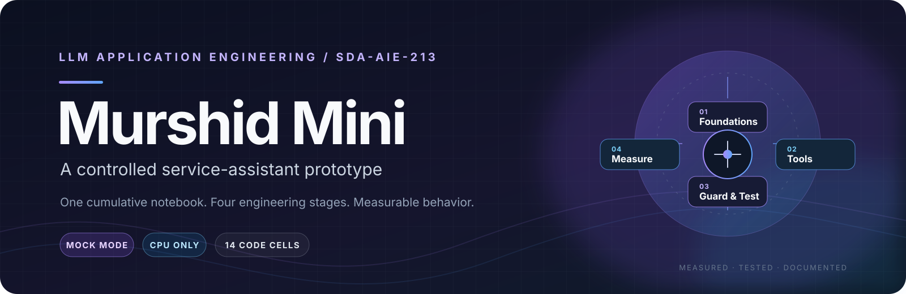
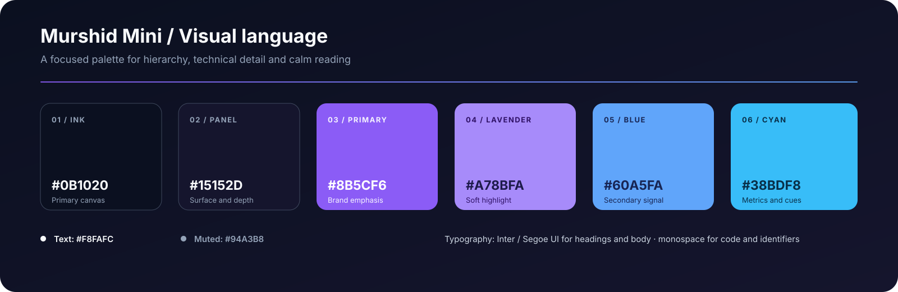
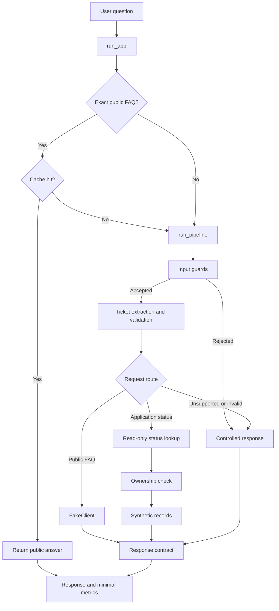
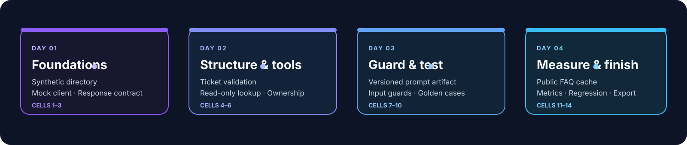

<div align="center">



**LLM Application Engineering · SDA-AIE-213**  
Instructor: Meaad Al-Marri


[](https://github.com/Elda98/large-language-models-application-engineering/actions/workflows/core-tests.yml)

</div>

<table>
<tr>
<td align="center" width="25%"><strong>10 / 10</strong><br><sub>Golden cases passed</sub></td>
<td align="center" width="25%"><strong>3 → 1</strong><br><sub>Mock calls with cache</sub></td>
<td align="center" width="25%"><strong>66.7%</strong><br><sub>Cache hit rate</sub></td>
<td align="center" width="25%"><strong>0</strong><br><sub>External API calls in core</sub></td>
</tr>
</table>

Murshid Mini is a four-day learning project that explores the engineering around an LLM-style service assistant: structured requests, controlled tool access, input validation, regression testing, and caching.

The core application uses a deterministic `FakeClient` and a small fictional dataset. **It runs in `mode=mock`; it is not a live language model, a government service, or a production application.** The optional real-model exercises are kept in separate notebooks and are documented separately from the core.

---

## Contents

- [Project overview](#project-overview)
- [Problem and approach](#problem-and-approach)
- [System design](#system-design)
- [Core capabilities](#core-capabilities)
- [Four-day development path](#four-day-development-path)
- [Evaluation and observed results](#evaluation-and-observed-results)
- [Technology and runtime](#technology-and-runtime)
- [Run the project](#run-the-project)
- [Repository structure](#repository-structure)
- [Synthetic data](#synthetic-data)
- [Optional homework](#optional-homework)
- [Limitations and next steps](#limitations-and-next-steps)
- [Course attribution](#course-attribution)
- [Project quality and contribution guides](#project-quality-and-contribution-guides)

## Project overview

The project models a small service-assistance workflow. A user can ask one of the supported public service questions or request the status of a fictional application. The application checks the request, follows a defined route, and returns a controlled response.

The intended audience is learners practicing the foundations of LLM application engineering: request design, validation, tool boundaries, testing, and operational measurement. The service scenario is fictional and is used as a consistent example across the four course days.

The four daily labs build one cumulative application in a single Colab notebook. Each stage extends the same codebase:

| Area | What the project demonstrates |
|---|---|
| Response handling | A defined response contract and trace information |
| Request structure | Ticket extraction, schema validation, and clarification |
| Tool access | A read-only status lookup with an ownership check |
| Input controls | Guards for selected invalid, unsupported, or unsuitable inputs |
| Reliability | Ten fixed behavioral cases and regression checks |
| Efficiency | Exact-match caching for eligible public questions |
| Reporting | JSON results, minimal metrics, and a final report |

## Problem and approach

A service assistant needs more than a response function. It must distinguish public information from private application data, reject requests it cannot safely handle, and behave consistently when the same request is repeated.

Murshid Mini explores those concerns with a deliberately small implementation.

| Engineering concern | Project approach |
|---|---|
| Unsupported or unsuitable questions | Apply input guards and return a controlled response |
| Missing or malformed request details | Extract and validate a structured ticket; ask for clarification when required |
| Application-status access | Use a read-only lookup and compare the record owner with the trusted demo session |
| Repeated public questions | Cache only the two exact public FAQ questions |
| Changes to application behavior | Use versioned prompt and directory identifiers, golden cases, and regression checks |
| Understanding runtime behavior | Record trace IDs, mock-call counts, tool-call counts, and Python execution time |

The prompt template is a versioned teaching artifact. The core mock client does not execute a real model prompt or generate language-model output.

## Visual design system

The repository uses a restrained palette derived from the project banner. Color is reserved for hierarchy and navigation; long-form text and technical tables remain neutral for comfortable reading.

<div align="center">

</div>

| Token | Hex | Intended use |
|---|---|---|
| Ink | `#0B1020` | Dark backgrounds and visual depth |
| Panel | `#15152D` | Secondary panels in visual assets |
| Primary violet | `#8B5CF6` | Main brand emphasis and section identity |
| Soft lavender | `#A78BFA` | Secondary highlights |
| Blue | `#60A5FA` | Technical and information cues |
| Cyan | `#38BDF8` | Metrics and final-stage accents |
| Main text | `#F8FAFC` | High-contrast text in dark assets |
| Muted text | `#94A3B8` | Supporting labels and metadata |

**Typography:** Inter or Segoe UI for headings and body text; monospace for code, paths, and identifiers.

**Application rule:** violet identifies the project, blue supports technical information, and cyan is reserved for measured outcomes. The palette is not applied to every paragraph or table; neutral text remains the default so the README stays readable.

## System design

The request path is intentionally separated into validation, routing, data access, and response handling.



### Cache boundary

The cache is outside the core request pipeline and is eligible only for the two exact public service-directory questions. Application-status requests, ticket overrides, and other questions bypass it.

The cache key includes the question text, language, model label, prompt version, and directory version. Entries expire after 300 seconds and contain only the public answer and creation time. Status values, owners, and session information are not cached.

### Status access boundary

The application reference is not treated as proof of ownership. The status tool checks the trusted session fixture against the owner stored in the synthetic record. It does not modify records. This demonstrates an authorization decision; it is not a production authentication mechanism.

## Core capabilities

| Component | Responsibility |
|---|---|
| `FakeClient` | Returns predefined public answers and counts mock calls |
| `ask` | Implements the Day 1 response contract and measures local Python time |
| `extract_ticket` | Extracts supported service, city, and reference fields using limited rules |
| `validate_ticket` | Checks the ticket structure, data types, and allowed values |
| `check_status` | Performs a read-only lookup after the ownership check |
| `route` | Chooses the supported public-answer, status, clarification, or refusal path |
| `guard_input` | Rejects selected unsuitable or malformed inputs |
| `evaluate` | Runs the ten fixed behavioral cases |
| `run_app` | Applies the public FAQ cache and records minimal operational metrics |

## Example interactions

The following examples use the synthetic records and the saved core behavior.

| Request | Expected core behavior | Why |
|---|---|---|
| `You can check your application status using its reference number.` | Return the supported English directory answer | Exact public FAQ |
| `ما حالة REF-1001؟` | `Application status: under_review` | The configured demo session owns `REF-1001` |
| `أريد حالة طلبي` | `ما رقم مرجع الطلب؟` | A reference is required before the status tool can be called |
| `ما حالة REF-1002؟` | `Unable to provide this application status.` | The record belongs to another demo user; its actual status is not disclosed |
| `cancel REF-1001` | `This demo is read-only; no application was changed.` | Mutating actions are outside the supported scope |

These are examples from the finite mock workflow, not evidence of general-purpose language understanding. The [technical documentation](docs/technical.md) explains the route, ticket schema, ownership check, and cache boundary in detail.

## Four-day development path

All four days are implemented in the same notebook, in the order shown below.

<div align="center">

</div>

| Day | Focus | Notebook cells | Main outcome |
|---|---|---:|---|
| 1 — Foundations | Synthetic service directory, mock client, `ask`, response contract | 1–3 | Baseline answers and response structure |
| 2 — Structure and tools | Ticket extraction, validation, read-only lookup, ownership check | 4–6 | Controlled status-request handling |
| 3 — Guard and test | Versioned prompt artifact, input guards, pipeline, golden cases | 7–10 | Ten fixed behavioral tests |
| 4 — Measure and finish | Public FAQ cache, measurements, regression, reporting, export | 11–14 | Cache comparison and final report |

## Evaluation and observed results


The results below come from the saved core notebook run. Trace IDs and execution times are run-specific; the stable checks are the response codes, call counts, cache-hit sequence, and golden-test outcomes.

### Core checks

| Day | Check | Observed result |
|---|---|---|
| 1 | Supported Arabic and English FAQs, plus clarification example | 3 expected responses |
| 2 | Status, clarification, missing record, unsupported action, and ownership denial | 5 scenarios; tool calls: `1, 0, 1, 0, 1` |
| 3 | Fixed golden test suite | **10 / 10 passed** |
| 4 | Cache comparison using the same FAQ three times | **3 mock calls without cache; 1 with cache** |
| 4 | Cache-hit sequence | `false, true, true` |
| 4 | Cache hit rate | **66.7%** |
| Final | External model API calls in the core | **0** |

### Day 4 cache experiment

| Measurement | Without cache | With initially empty cache |
|---|---:|---:|
| Requests | 3 | 3 |
| Mock-client calls | 3 | 1 |
| Cache hits | 0 | 2 |
| Hit rate | 0% | 66.7% |

This is a controlled comparison of mock-call counts. It does not establish a guaranteed latency improvement or a real financial saving.

The final report also contains a hypothetical cost calculation of **USD 0.0036 per request** using illustrative token prices. It is labeled as an example only; it is not a provider price, invoice, or measured saving.

### Result files

The core notebook writes these files to `murshid_outputs/` and packages the JSON files into `murshid_submission.zip`:

- [Baseline results](results/core/baseline_results.json)
- [Day 2 results](results/core/day2_results.json)
- [Day 3 results](results/core/day3_results.json)
- [Day 4 cache results](results/core/day4_results.json)
- [Final report](results/core/final_report.json)
- [Metrics](results/core/metrics.json)
- [Synthetic data export](results/core/synthetic_data.json)

The ZIP contains the JSON outputs, not the notebook. Save and submit `notebooks/murshid.ipynb` separately.

## Technology and runtime

| Technology | Use |
|---|---|
| Python 3.9+ | Core application logic |
| Google Colab | Notebook development and execution |
| Python standard library | Validation, timing, JSON, UUIDs, and ZIP export |
| JSON | Synthetic data and result artifacts |
| Mermaid | Architecture documentation |
| GitHub | Source control and project submission |

The core project runs on CPU. It requires no package installation, API key, paid endpoint, GPU, or model download.

## Run the project


### Open in Google Colab

[Open the cumulative notebook in Colab](https://colab.research.google.com/github/Elda98/large-language-models-application-engineering/blob/main/notebooks/murshid.ipynb)

1. Save your own copy to Google Drive before editing.
2. Select a Python 3 runtime with CPU and no hardware accelerator.
3. Restart the runtime.
4. Run all 14 cells from the beginning, in order.
5. Review the printed checks and the final report.
6. In the Colab Files panel, download `murshid_submission.zip` to keep the generated JSON evidence.

### Run the repository checks

From the repository root, run:

```bash
python -m unittest discover -s tests -v
```

The repository includes ten offline test methods covering notebook structure and cell order, full execution and export, daily milestones, repeatability, standard-library imports, ticket validation, ownership, input guards, cache behavior, and consistency of the committed result files. GitHub Actions runs the suite on Python 3.11 and Python 3.13 for pushes and pull requests. These checks supplement the ten golden cases in the notebook; they do not replace them.

## Repository structure

```text
.
├── README.md
├── assets/
│   ├── murshid-hero.svg
│   ├── design-system.svg
│   ├── four-day-journey.svg
│   └── section-accent.svg
├── notebooks/
│   └── murshid.ipynb
├── data/
│   ├── README.md
│   └── synthetic_data.json
├── docs/
│   ├── project-notes.md
│   └── technical.md
├── homework/
│   ├── day1/
│   ├── day2/
│   ├── day3/
│   └── day4/
├── results/
│   ├── README.md
│   └── core/
│       ├── baseline_results.json
│       ├── day2_results.json
│       ├── day3_results.json
│       ├── day4_results.json
│       ├── final_report.json
│       ├── metrics.json
│       └── synthetic_data.json
├── tests/
│   └── test_notebook.py
├── .github/
│   └── workflows/
│       └── core-tests.yml
├── CONTRIBUTING.md
├── CHANGELOG.md
└── .gitignore
```

## Synthetic data

The project does not download a dataset. Its small teaching dataset is defined in the notebook and exported as `synthetic_data.json`.

| Reference | Owner | Status |
|---|---|---|
| `REF-1001` | `demo-user-1` | `under_review` |
| `REF-1002` | `demo-user-2` | `approved` |
| `REF-9999` | Not present | Used for a missing-record case |

The trusted demo session is `demo-user-1`. The public directory contains one Arabic and one English answer. These identities, references, and statuses are fictional examples, not actual service or government records.

See the [dataset card](data/README.md) for the complete field definitions, ticket schema, and data boundaries.

## Optional homework

The extra assignments use separate notebooks. They do not become part of the cumulative core notebook and do not change its `mode=mock` behavior.

| Day | Exercise | Files |
|---|---|---|
| 1 | Generate an answer with a real local model | [Notebook](homework/day1/day1_real_model_Raghad.ipynb) · [Observed result](homework/day1/live_demo_result.json) |
| 2 | Validate and dispatch structured tool calls | [Notebook](homework/day2/day2_tools_raghad.ipynb) |
| 3 | Practice deliberate errors and input validation | [Notebook](homework/day3/day3_errors_raghad.ipynb) |
| 4 | Evaluate three real-model FAQ answers | [Notebook](homework/day4/day4_evaluation_raghad.ipynb) · [Evaluation report](homework/day4/evaluation_result.json) |

The Day 1 and Day 4 exercises load `google/flan-t5-small` locally. Their reports record zero external inference API calls. They require internet access to download packages and model weights, but no paid API key or hosted inference endpoint. The Day 1 and Day 4 notebooks use `sentencepiece==0.2.1` as a compatibility adjustment for the Python 3.13 Colab environment; the supplied `0.2.0` source package failed to build there.

The Day 4 keyword indicator checks for the words “reference” and “number”. It is a lexical proxy, not a semantic-accuracy score. The manual review is included separately in the homework notebook.

## Limitations and next steps

The core is intentionally limited:

- The mock recognizes a finite set of supported questions; it is not general-purpose language understanding.
- The core does not load or evaluate a live language model.
- The prompt template is not executed by the mock client.
- The status records and identities are synthetic.
- The ownership check is an educational authorization example, not real authentication.
- Input guards cover selected examples only and are not comprehensive security controls.
- Ten passing golden cases demonstrate those test cases, not general reliability.
- Python execution time is not model-inference latency.

Possible next steps include expanding the synthetic test set, adding more paraphrase and boundary cases, and comparing the mock workflow with a separately evaluated local model.

## Course attribution

This project was completed as part of **LLM Application Engineering — SDA-AIE-213**, a guided four-day learning journey by **Meaad Al-Marri**.

- [Course reference repository](https://github.com/almiyead-rgb/murshid-llm-application-engineering-sda-aie-213)
- [SDAIA Academy on GitHub](https://github.com/SDAIAAcademy)

The attribution identifies the learning context. It does not imply that SDAIA Academy endorsed, certified, or authored this implementation.

## Project quality and contribution guides

- [Contribution guidelines](CONTRIBUTING.md)
- [Change history](CHANGELOG.md)
- [Automated test workflow](.github/workflows/core-tests.yml)
- [Project design notes](docs/project-notes.md)
- [Technical documentation](docs/technical.md)

The repository intentionally does not include a license file. Add a license only after choosing terms that reflect how you want others to use the project.
